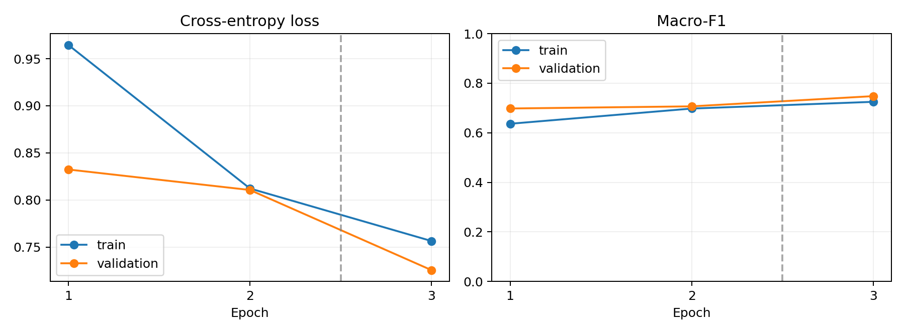
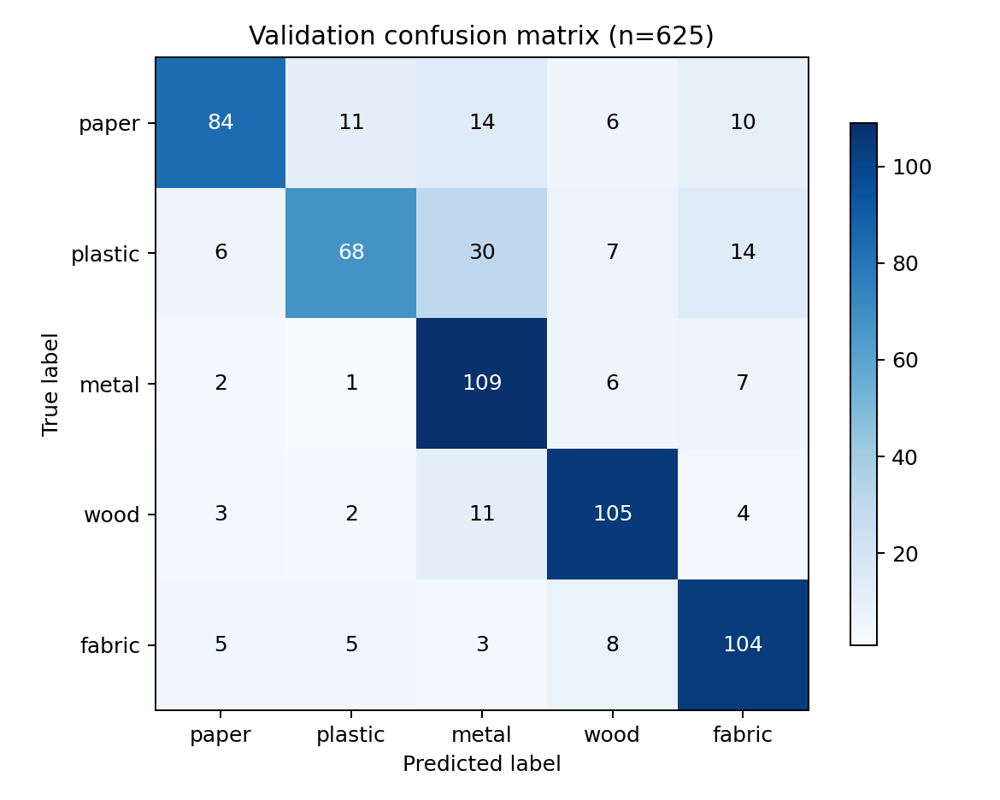
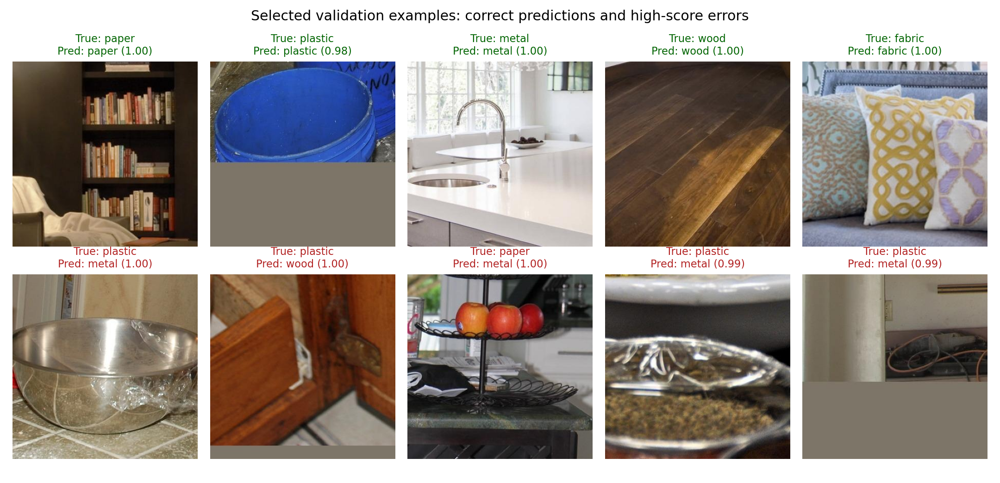

# 仓储机器人表面材质识别第一周周报

报告日期：2026-09-26。公开数据线完成第一周基线；企业数据线等待图像与标注。

完整验证集 Accuracy **75.20%**，Macro-F1 **0.7480**；验证集参与选模，不是独立测试成绩。

## 完成情况

- 已下载五类 MINC 全集 12,500 张：训练 10,625、验证 625、测试 1,250；保留官方划分。
- 图片解码与清单检查通过，跨集合无字节级重复。
- 完成分类头 2 轮、全网络 1 轮，最佳为总第 3 轮。
- 实际训练设备：cpu，PyTorch 2.8.0+cpu；训练及每轮验证合计 17.2 分钟。
- 已准备模型权重、ROI Demo、逐图预测、训练曲线、混淆矩阵及标注规范。

## 逐类验证指标

| 材质 | Precision | Recall | F1 | 数量 |
| --- | ---: | ---: | ---: | ---: |
| 纸质 | 0.840 | 0.672 | 0.747 | 125 |
| 塑料 | 0.782 | 0.544 | 0.642 | 125 |
| 金属 | 0.653 | 0.872 | 0.747 | 125 |
| 木材 | 0.795 | 0.840 | 0.817 | 125 |
| 织物 | 0.748 | 0.832 | 0.788 | 125 |

## 每轮记录

| 总轮次 | 阶段 | 训练准确率 | 验证准确率 | 验证 Macro-F1 | 秒 |
| ---: | --- | ---: | ---: | ---: | ---: |
| 1 | head | 63.63% | 69.76% | 0.6980 | 239.8 |
| 2 | head | 69.78% | 70.56% | 0.7067 | 234.9 |
| 3 | full | 72.47% | 75.20% | 0.7480 | 559.5 |

## 结果图

样例为每类一个正确样本和高分错误样本，不是随机抽样；softmax 分数尚未做概率校准。

## 未完成项与下一周

- Python 3.12 CUDA 环境的小样本训练已完成，验证准确率 54.00%；完整基线使用 CPU，数据规模不同不可直接比较。
- GPU 初期同步异常、连续运算低效，原因未确认；恢复显卡状态后再完成全量 GPU 训练。见 gpu_environment.md。
- 企业数据尚未提供，未完成现场基线、跨 SKU 测试或真空吸盘验证。
- 下周固定 GPU 环境，适配企业标注与 ROI/SKU 字段，固定测试 SKU；冻结公开 POC 后再评估保留测试集。
- 当前模型只识别已知五类，不包含完整 unknown 拒识能力。

权重、配置和实验历史：`runs/week1_resnet18`。Word 周报：`deliverables/第一周周报.docx`。
